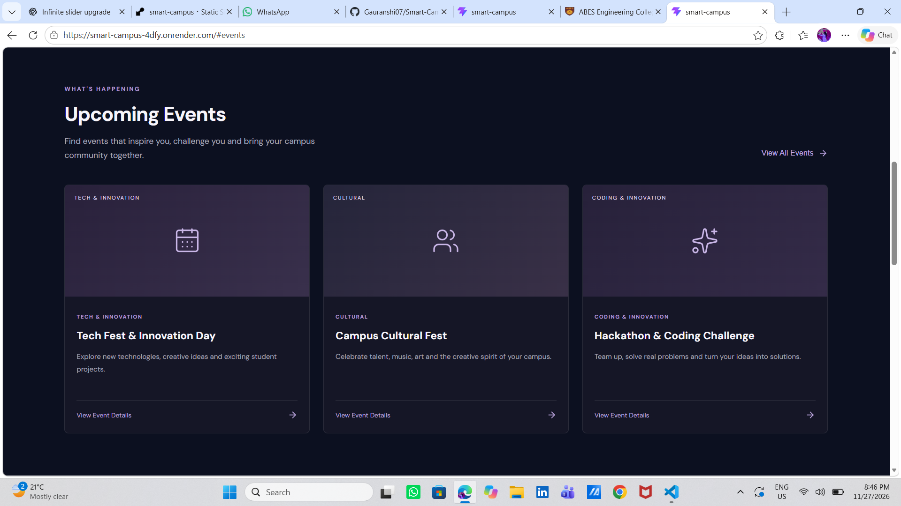
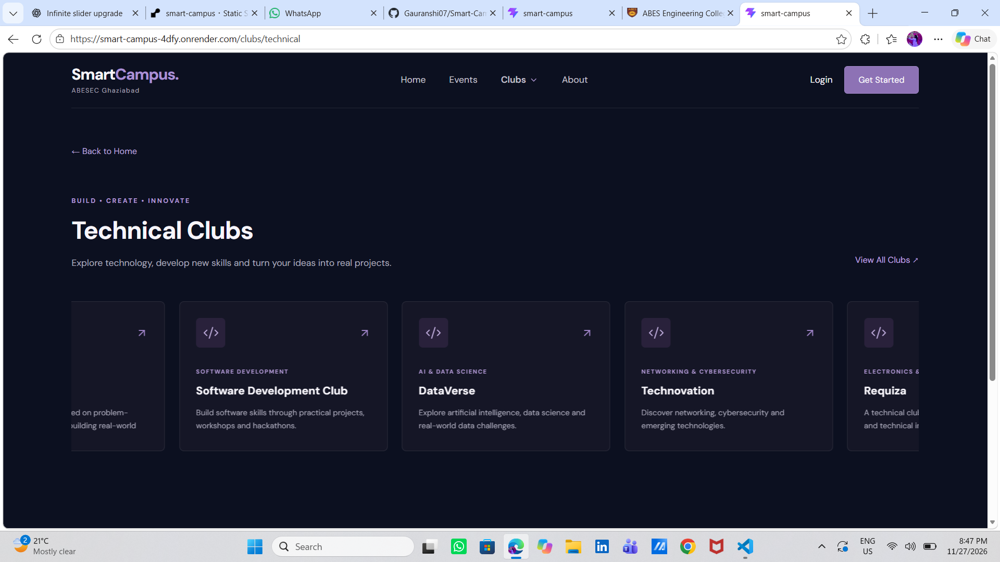
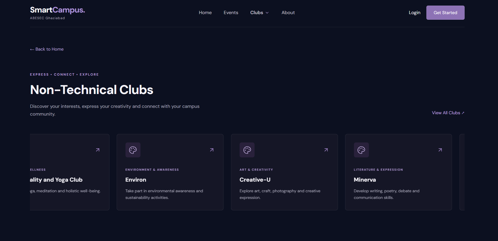
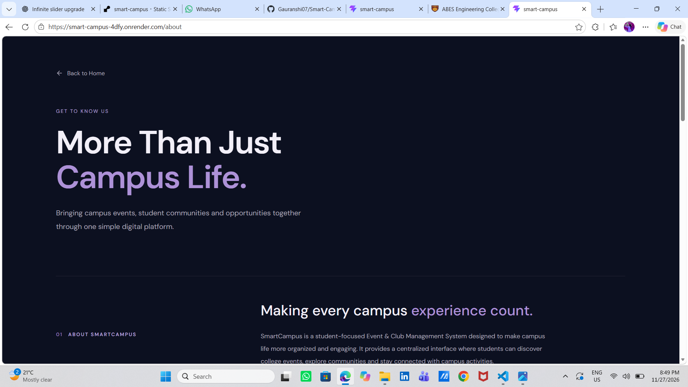

# SmartCampus – Smart Campus Event & Club Management System

<p align="center">
  
</p>

<h3 align="center">Making Campus Life More Connected.</h3>

<p align="center">
  A centralized digital platform for discovering campus events, exploring student clubs, and staying connected with college activities.
</p>

<p align="center">
  <a href="https://smart-campus-4dfy.onrender.com/">🌐 Live Demo</a> •
  <a href="https://github.com/Gauranshi07/Smart-Campus-Event-Management-System">GitHub Repository</a>
</p>

---

## 🚀 About the Project

**SmartCampus** is a Student-focused Event & Club Management System designed for ABES Engineering College, Ghaziabad.

The platform provides students with a centralized place to discover upcoming college events, explore technical and non-technical clubs, and stay connected with campus activities.

The project currently includes a frontend implementation. Backend development and database integration are planned as the next phase.

## ✨ Features

- **Modern Landing Page:** Clean and interactive homepage with a campus image carousel.
- **Event Discovery:** Explore upcoming campus events across different categories.
- **Technical Clubs:** Discover technology-focused student communities.
- **Non-Technical Clubs:** Explore cultural, creative, literary and other student clubs.
- **About Page:** Learn about the platform and its purpose.
- **Responsive UI:** Dark-themed interface with a consistent visual design.
- **Easy Navigation:** Dedicated pages and navigation for different sections.

## 🖥️ Screenshots

### 1. Home Page


### 2. Events Section


### 3. Technical Clubs


### 4. Non-Technical Clubs


### 5. About Page


## 🛠️ Tech Stack

| Technology | Purpose |
|---|---|
| React.js | Frontend development |
| JavaScript (ES6+) | Application logic |
| HTML5 | Structure |
| CSS3 | Styling and animations |
| Vite | Development and build tool |
| Git & GitHub | Version control |
| Render | Frontend deployment |

## 📂 Project Structure

```text
smart-campus/
│
├── public/
│
├── src/
│   ├── assets/
│   ├── components/
│   ├── pages/
│   ├── App.jsx
│   └── main.jsx
│
├── screenshots/
│
├── index.html
├── package.json
├── package-lock.json
├── vite.config.js
└── README.md
```

*Note: The structure represents the main project organization.*

## ⚙️ Getting Started

Follow these steps to run the project locally.

**1. Clone the repository**

```bash
git clone https://github.com/Gauranshi07/Smart-Campus-Event-Management-System.git
```

**2. Navigate to the project directory**

```bash
cd Smart-Campus-Event-Management-System/smart-campus
```

**3. Install dependencies**

```bash
npm install
```

**4. Start the development server**

```bash
npm run dev
```

Open the local URL provided by Vite in your browser.

**5. Create a production build**

```bash
npm run build
```

## 🔮 Future Enhancements

The next development phase will focus on backend integration and functional features:

- User authentication and authorization.
- Student registration and login.
- Admin dashboard for managing events and clubs.
- Dynamic event creation and management.
- Club registration and membership management.
- Event registration for students.
- Database integration for persistent data storage.
- REST API integration between frontend and backend.

## 🌐 Deployment

**Live Project:** https://smart-campus-4dfy.onrender.com/

**Platform:** Render (Static Site)

## 👩‍💻 Developer

**Gauranshi Varshney**

Full Stack Development

ABES Engineering College, Ghaziabad

---

<p align="center">
  Made with ❤️ for a better campus experience.
</p>